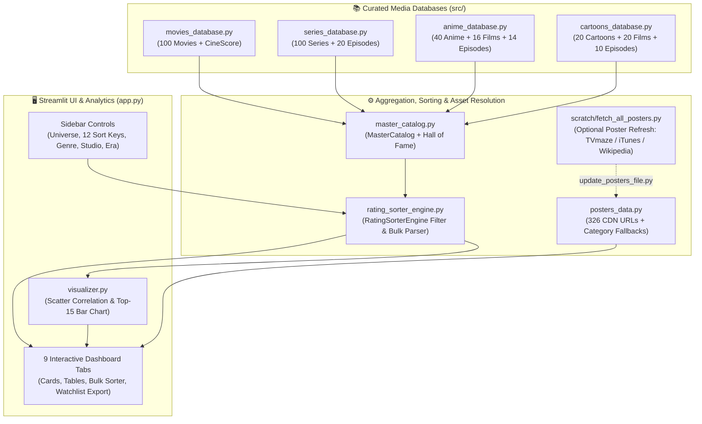

<h1 align="center">🎬 CineScore™ Universe — Multi-Source Cinema, Series, Anime &amp; Animation Intelligence</h1>

<p align="center">
  <strong>An interactive Streamlit and Plotly analytics platform that aggregates multi-source critic and audience scores across IMDb, Rotten Tomatoes, Metacritic, MyAnimeList (MAL), and Letterboxd into normalized composite CineScore™ (0–100) benchmarks for 340 curated films, TV series, anime, cartoons, and peak-rated episodes.</strong>
</p>

<p align="center">
  <a href="#-executive-overview"><b>Overview</b></a> •
  <a href="#-media-universes-and-catalog-coverage"><b>Media Universes</b></a> •
  <a href="#-dashboard-modules-and-capabilities"><b>Modules</b></a> •
  <a href="#-composite-cinescore-methodology"><b>Scoring Model</b></a> •
  <a href="#-system-architecture"><b>Architecture</b></a> •
  <a href="#-repository-structure"><b>Structure</b></a> •
  <a href="#-installation-and-usage"><b>Quickstart</b></a>
</p>

<p align="center">
  
  
  
  
</p>

<p align="center">
  
  
  
  
</p>

---

## 🌐 Executive Overview

**CineScore™ Universe** unifies cross-platform media evaluation into a single dark-themed Streamlit intelligence workspace. Rather than comparing raw 10-point IMDb scores against percentage-based Rotten Tomatoes Tomatometer ratings, 100-point Metacritic Metascores, or 5-star Letterboxd averages in isolation, the platform computes format-specific **CineScore™ (0–100)** composite indices across seven curated entertainment categories.

Designed for film analysts, anime enthusiasts, data visualization practitioners, and curators building watchlists, the platform runs **100% locally with zero external API keys required at runtime**, pairing deterministic sorting/filtering (`RatingSorterEngine`) with interactive Plotly correlation visuals and instant watchlist exports.

---

## 🌌 Media Universes and Catalog Coverage

`MasterCatalog` (`src/master_catalog.py`) indexes **340 total entries** across **7 media universes** (`296` core titles in the combined `"All Media Universe"` view plus `44` Hall of Fame episodes):

| # | Universe Category | Source Dataset | Curated Count | Rating Inputs Used |
|---|---|---|---|---|
| **1** | **🎬 Top 100 Movies** | `src/movies_database.py` (`MASTER_MOVIES_DB`) | `100` | IMDb, Rotten Tomatoes, Metacritic, Letterboxd |
| **2** | **📺 Top 100 TV Series** | `src/series_database.py` (`MASTER_SERIES_DB`) | `100` | IMDb, Rotten Tomatoes, Metacritic |
| **3** | **🎌 Top 100 Anime Series** | `src/anime_database.py` (`MASTER_ANIME_DB`) | `40` | MyAnimeList (`mal_score`), IMDb, Rotten Tomatoes baseline |
| **4** | **🎌 Top Anime Movies** | `src/anime_database.py` + `src/master_catalog.py` (`FORMATTED_ANIME_MOVIES`) | `16` | MyAnimeList (`mal_score`), IMDb, Rotten Tomatoes |
| **5** | **🎨 Top 100 Cartoons** | `src/cartoons_database.py` (`MASTER_CARTOONS_DB`) | `20` | IMDb, Rotten Tomatoes, Letterboxd baseline |
| **6** | **🎨 Top 100 Animated Feature Films** | `src/cartoons_database.py` + `src/master_catalog.py` (`FORMATTED_ANIMATED_MOVIES`) | `20` | IMDb, Rotten Tomatoes |
| **7** | **🏆 Hall of Fame Legendary Episodes** | `TOP_SERIES_EPISODES` (`20`) + `TOP_ANIME_EPISODES` (`14`) + `TOP_CARTOON_EPISODES` (`10`) | `44` | IMDb rating & vote count (sorted descending, 9.4–10.0 ⭐ peak tiers) |

> **Poster Asset Resolution (`src/posters_data.py`)**: Includes `326` pre-resolved artwork URLs (`POSTERS_CATALOG`) sourced via TMDb, TVmaze, Apple iTunes, and Wikimedia CDNs, with automatic parent-series fallback for episodes and category-specific HD fallbacks (`CATEGORY_FALLBACKS`).

---

## 🧩 Dashboard Modules and Capabilities

The interface in `app.py` organizes exploration, parsing, visualization, and export across **9 interactive tabs** coupled with a live sidebar filtering engine:

| Tab | Module | Key Capabilities |
|---|---|---|
| **1** | `🌟 Universal Catalog & Cards` | Displays up to the top 100 filtered cards across the chosen universe with CineScore badges, platform pills, streaming tags, and peak-episode callouts. |
| **2** | `🎬 Top 100 Movies` | Toggle between visual cinema cards and a full tabular view including Oscars, Box Office ($M), Letterboxd, Metacritic, RT %, and IMDb scores. |
| **3** | `📺 Top 100 TV Series` | Toggle between visual series cards and a spreadsheet grid showing start/end years, seasons, episodes, creators, and highest-rated episode. |
| **4** | `🎌 Anime Universe` | Two dedicated sub-tabs for **Top Anime Series (with MAL Scores)** (including Japanese romaji titles and studios) and **Top Anime Feature Films**. |
| **5** | `🎨 Cartoons & Animation` | Two dedicated sub-tabs covering **Top 100 Cartoon Series** and **Top 100 Animated Feature Films** (Pixar, Disney, DreamWorks, Sony). |
| **6** | `🏆 Hall of Fame Episodes (9.8 - 10.0)` | Ranks landmark television, anime, and animated episodes (*Ozymandias*, *Hero*, *Battle of the Bastards*, *Sozin's Comet*, *The View from Halfway Down*). |
| **7** | `📋 Custom Bulk Sorter` | `RatingSorterEngine.parse_user_raw_list()` strips numbered prefixes and `(YYYY)` suffixes, matches pasted titles across the catalog, and ranks by CineScore™. |
| **8** | `📊 Analytics & Plots` | Interactive Plotly visualizations via `src/visualizer.py`: IMDb vs. Critics scatter correlation (`create_ratings_scatter_plot`) and Top-15 CineScore bar leaderboard (`create_cinescore_distribution_bar`). |
| **9** | `💾 Data Export` | One-click CSV (`cinescore_<category>.csv`) and JSON (`cinescore_universe.json`) downloads for any filtered slice, plus a ready-to-paste Markdown checklist (top 30 items). |

### Sidebar Sorter, Filters & Telemetry Controls
- **12 Sort Criteria** (`RatingSorterEngine.filter_and_sort`): `CineScore (0-100)`, `IMDb Rating (0-10)`, `MyAnimeList (MAL Score)`, `Rotten Tomatoes (%)`, `Metacritic Score (0-100)`, `Letterboxd (0-5)`, `Release Year`, `Box Office ($M)`, `Runtime (Mins)`, `Oscar Wins`, `Seasons Count`, and `Episodes Count` (ascending or descending).
- **Multi-Facet Filtering**: Keyword search across titles, parent series, directors, studios, creators, cast, and plots; Genre selector; Director/Studio/Creator selector; Streaming Platform filter; Minimum IMDb slider (`0.0–9.8`); Release Era range slider (`1930–2026`).
- **Live Sync Toggle**: Optional 10-second `streamlit_autorefresh` cycle counter and UTC sync timestamp badge.

---

## 📐 Composite CineScore Methodology

Each media format uses domain-calibrated weights implemented directly in `src/` to map heterogeneous rating scales onto a unified $[0, 100]$ index:

1. **Feature Films** (`calculate_cinescore` in `src/movies_database.py`):
   $$\text{CineScore}_{\text{movie}} = 0.35 \left(\frac{\text{IMDb}}{10} \times 100\right) + 0.30\,\text{RT} + 0.20\,\text{Metacritic} + 0.15 \left(\frac{\text{Letterboxd}}{5} \times 100\right)$$

2. **TV Series** (`calculate_series_cinescore` in `src/series_database.py`):
   $$\text{CineScore}_{\text{series}} = 0.45 \left(\frac{\text{IMDb}}{10} \times 100\right) + 0.35\,\text{RT} + 0.20\,\text{Metacritic}$$

3. **Anime Series & Anime Feature Films** (`calculate_anime_cinescore` in `src/anime_database.py` & `FORMATTED_ANIME_MOVIES` in `src/master_catalog.py`):
   $$\text{CineScore}_{\text{anime}} = 0.50 \left(\frac{\text{MAL}}{10} \times 100\right) + 0.35 \left(\frac{\text{IMDb}}{10} \times 100\right) + 0.15\,\text{RT}$$
   *(Series entries without per-row RT scores use the default baseline $\text{RT} = 90$.)*

4. **Western Cartoon Series** (`calculate_cartoon_cinescore` in `src/cartoons_database.py`):
   $$\text{CineScore}_{\text{cartoon}} = 0.45 \left(\frac{\text{IMDb}}{10} \times 100\right) + 0.35\,\text{RT} + 0.20 \left(\frac{\text{Letterboxd}}{5} \times 100\right)$$
   *(Defaults to baseline $\text{Letterboxd} = 4.0$ when not explicitly populated.)*

5. **Western Animated Feature Films** (`FORMATTED_ANIMATED_MOVIES` in `src/master_catalog.py`):
   $$\text{CineScore}_{\text{animated}} = 45 \left(\frac{\text{IMDb}}{10}\right) + 0.35\,\text{RT} + 18.0$$

---

## 🏗️ System Architecture



---

## 📂 Repository Structure

```text
cine-rating-sorter-platform/
├── .devcontainer/
│   └── devcontainer.json             # Python 3.11 Dev Container configuration
├── scratch/
│   ├── fetch_all_posters.py          # Optional poster resolver (TVmaze, iTunes, Wikipedia REST API)
│   ├── posters_data_full.json        # Cached JSON mapping of 326 resolved poster URLs
│   └── update_posters_file.py        # Regenerates src/posters_data.py from posters_data_full.json
├── src/
│   ├── __init__.py                   # Package initialization
│   ├── anime_database.py             # Top anime series, anime feature films & peak anime episodes
│   ├── cartoons_database.py          # Top cartoon series, animated feature films & peak episodes
│   ├── master_catalog.py             # Unified MasterCatalog & Hall of Fame episode aggregator
│   ├── movies_database.py            # Top 100 cinema masterpieces & movie CineScore calculator
│   ├── posters_data.py               # 326 curated poster URLs & get_media_poster() resolver
│   ├── rating_sorter_engine.py       # Multi-criteria filtering, sorting & bulk title parser
│   ├── series_database.py            # Top 100 TV series & legendary TV episodes
│   └── visualizer.py                 # Plotly scatter correlation & CineScore bar chart builders
├── .gitattributes                    # Git LF line-ending auto-detection
├── .gitignore                        # Python, venv, and .env ignore rules
├── app.py                            # Main Streamlit dashboard application (9 tabs)
├── LICENSE                           # Apache License 2.0
├── README.md                         # Project documentation
└── requirements.txt                  # Python package dependencies
```

---

## 🚀 Installation and Usage

### Prerequisites
- **Python**: `3.10` or higher (`3.11` configured in `.devcontainer/devcontainer.json`).
- **Git** *(optional, for cloning)*.

### 1. Clone the Repository
```bash
git clone https://github.com/khalid-naami/cine-rating-sorter-platform.git
cd cine-rating-sorter-platform
```

### 2. Create & Activate a Virtual Environment
```powershell
# Windows PowerShell
python -m venv .venv
.\.venv\Scripts\Activate.ps1
```

```bash
# macOS / Linux
python3 -m venv .venv
source .venv/bin/activate
```

### 3. Install Dependencies
```bash
pip install -r requirements.txt
```
Core packages installed from `requirements.txt`: `streamlit>=1.35.0`, `pandas>=2.0.0`, `numpy>=1.24.0`, `requests>=2.31.0`, `plotly>=5.18.0`, `scipy>=1.11.0`, `streamlit-autorefresh>=1.0.1`.

### 4. Launch the Application
```bash
streamlit run app.py
```
The dashboard launches locally at `http://localhost:8501`. No API keys or `.env` variables are required.

### 5. Optional: Refresh Poster Assets
If you expand the curated databases in `src/`, you can resolve missing poster URLs via public endpoints (TVmaze, Apple iTunes Search, and Wikipedia REST APIs) and regenerate `src/posters_data.py`:
```bash
python scratch/fetch_all_posters.py
python scratch/update_posters_file.py
```

---

## 📡 Data Sources & License

- **Rating & Metadata Schemas**: Curated multi-source benchmark datasets spanning **IMDb**, **Rotten Tomatoes**, **Metacritic**, **MyAnimeList (MAL)**, and **Letterboxd**.
- **Artwork CDNs**: Pre-resolved poster URLs hosted on **TMDb**, **TVmaze**, **Apple iTunes**, and **Wikimedia** with **Unsplash** category fallbacks.
- **License**: Licensed under the **Apache License, Version 2.0** — see [LICENSE](LICENSE) for full terms.
